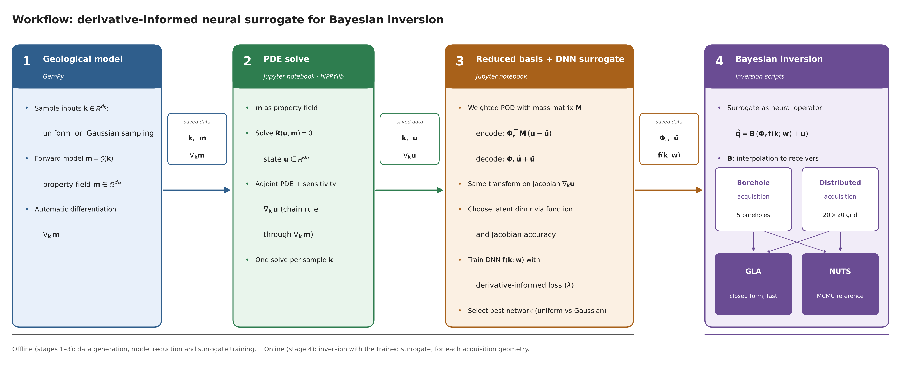

# GempyDINO

Create an environment with Python version `python=3.10.13`, then install GemPy and its related packages with the following versions:

- `gempy==2023.2.0b1`
- `gempy-engine==2023.2.0b1`
- `gempy-probability==2023.2.0b1`
- `gempy-viewer==2023.2.0b1`

```bash
conda create -n gempy_dino python=3.10.13
conda activate gempy_dino
pip install gempy==2023.2.0b1 gempy-engine==2023.2.0b1 gempy-probability==2023.2.0b1 gempy-viewer==2023.2.0b1
```

**Derivative-informed neural operator surrogates for Bayesian inversion of geological models**

GempyDINO couples a [GemPy](https://www.gempy.org/) structural geological model with a PDE forward model in [hIPPYlib](https://hippylib.github.io/). It trains a **derivative-informed neural network (DINO)** surrogate on a reduced basis, then uses that surrogate for fast Bayesian inversion of geological interface positions. This repository holds the code, notebooks and trained models that accompany the paper.



---

## Overview

The workflow has an **offline** phase (stages 1–3: data generation, model reduction and surrogate training) and an **online** phase (stage 4: inversion with the trained surrogate).

| Stage | What happens | Tools | Saved data |
|---|---|---|---|
| **1. Geological model** | Sample the geological inputs **k** ∈ ℝ^{d_K} (interface positions) from a uniform or Gaussian prior. Map them to a property field **m** = 𝒢(**k**) ∈ ℝ^{d_M}, and get ∇ₖ**m** by automatic differentiation. | GemPy, PyTorch | **k**, **m**, ∇ₖ**m** |
| **2. PDE solve** | Use **m** as the coefficient field and solve **R**(**u**, **m**) = 0 for the state **u** ∈ ℝ^{d_U}. An adjoint/sensitivity solve gives ∇ₖ**u** through the chain rule via ∇ₖ**m**. There is one solve per sample **k**. | FEniCS, hIPPYlib, MPI | **k**, **u**, ∇ₖ**u** |
| **3. Reduced basis + DNN surrogate** | Weighted POD with mass matrix **M**: encode Φᵣᵀ**M**(**u** − ū), decode Φᵣû + ū. The Jacobian ∇ₖ**u** is projected the same way. Choose the latent dimension *r* from function and Jacobian accuracy. Then train a DNN **f**(**k**; **w**) with a derivative-informed loss (weight λ) and pick the best network (uniform vs Gaussian training data). | PyTorch, Jupyter | Φᵣ, ū, **f**(**k**; **w**) |
| **4. Bayesian inversion** | The surrogate acts as a neural operator, **q̂** = **B**(Φᵣ **f**(**k**; **w**) + ū), where **B** interpolates to the receivers. Inversion is run for two acquisition geometries with two posterior methods. | Pyro, hIPPYlib | posterior samples, plots |

**Acquisition geometries**
- **Borehole:** 5 vertical boreholes
- **Distributed:** a 20 × 20 grid of receivers

**Posterior methods**
- **GLA** (Gaussian/Laplace approximation): closed form and fast
- **NUTS** (No-U-Turn Sampler, MCMC): used as the reference posterior

### Forward problem

The PDE is solved on the unit square (32 × 32 mesh, 1024 nodes) with a heterogeneous coefficient field **m** from GemPy:

$$
-\nabla \cdot \left( m \, \nabla u \right) = 0 \quad \text{in } \Omega = [0,1]^2,
\qquad u = y \ \text{on the top and bottom boundaries}
$$

The state uses P2 Lagrange elements and the parameter uses P1 elements.

---

## Test cases

Two synthetic geological models are included. Each has a uniform and a Gaussian sampling variant:

| Folder | Description |
|---|---|
| `SD2LSP/` | Salt Dome 2-layer structural model single parameter|
| `SD3LMP/` | Salt Dome 3-layer structural model multiple parameter|


## Repository structure

```
GempyDINO/
├── workflow.png                  # Workflow figure (above)
├── environment.yml               # Conda environment (osx-arm64)
├── requirements.txt              # Package list
├── SD2LSP/ , SD3LMP/
│   ├── NN_ac(c)uracies.ipynb     # Surrogate accuracy comparison across settings
│   ├── Noise_1.ipynb             # Inversion results, 1% noise
│   ├── Noise_5.ipynb             # Inversion results, 5% noise
│   └── uniform/ , gaussian/
│       ├── Initial_sp.csv / Initial_op.csv  # GemPy surface points and orientations
│       ├── generate_samples(2).py # GemPy model, sampling, ∇ₖm via autodiff
│       ├── save_gempy_data.py     # Stages 1–2: generate and store training data (MPI)
│       ├── generate_sample.sh     # SLURM job script for save_gempy_data.py
│       ├── POD_and_reductions.ipynb  # Stage 3: weighted POD, latent dimension choice
│       ├── NN_training.ipynb      # Stage 3: DNN training (with/without Jacobian loss)
│       ├── train_nn.py            # Network definitions and training routines
│       ├── helpers.py             # Shared utilities
│       ├── gradient.py            # Gradient of the posterior used by GLA
│       ├── Borehole.py            # Stage 4: inversion, borehole acquisition (uniform only)
│       ├── Distributed.py         # Stage 4: inversion, distributed acquisition (uniform only)
│       ├── inversion_simplified.py # Cleaned-up inversion script (SD3LMP/uniform)
│       └── saved_model/           # Φᵣ, MΦᵣ, ū and trained networks (.pth)
└── Results/<model>/<sampling>/Nodes_1024/
    ├── gempy_data.h5              # k, m, ∇ₖm, u, ∇ₖu samples
    ├── POD_data.h5                # Reduced data for training
    └── POD_eig.h5                 # POD eigenvalues
```

Trained networks are named `model_{jacobian_full|without_jacobian}_{N}_{epochs}.pth`. Here `N` is the number of training samples (64 to 8192) and `epochs` is the training length. `jacobian_full` networks use the derivative-informed loss; `without_jacobian` networks use the plain L² loss.

> The files in `Results/` are large (up to ~2 GB each) and are not stored in git. Regenerate them with stages 1–3 below.

---

## Installation

The code was developed with **Python 3.10.13**. It needs:

- `gempy==2023.2.0b1`, `gempy-engine==2023.2.0b1`, `gempy-probability==2023.2.0b1`, `gempy-viewer==2023.2.0b1`
- `fenics==2019.1.0` (legacy DOLFIN) and `hippylib==3.1.0`, plus `hippyflow`
- `torch==2.3.1`, `pyro-ppl==1.9.1`, `arviz`, `h5py`, `mpi4py`

The easiest route is the provided conda environment:

```bash
git clone https://github.com/Deepprakash222/GempyDINO.git
cd GempyDINO
conda env create -f environment.yml
conda activate gempy_dino
```

`environment.yml` was exported on macOS (Apple Silicon). On Linux/HPC, create a Python 3.10 environment, install FEniCS 2019.1.0 from conda-forge, then install the pip packages listed above.

---

## Usage

Run every script from inside the case folder, for example `SD3LMP/uniform/`. The scripts use the folder names to find their `Results/` path.

**1–2. Generate training data** (GemPy samples, PDE solves, Jacobians):

```bash
cd SD3LMP/uniform
mpirun -n 32 python save_gempy_data.py
# or, on a SLURM cluster:
sbatch generate_sample.sh
```

**3. Reduce and train the surrogate.** Run the notebooks in this order:
1. `POD_and_reductions.ipynb`: computes the weighted POD basis and picks the latent dimension *r*
2. `NN_training.ipynb`: trains DNNs with and without the derivative-informed loss and saves them to `saved_model/`

**4. Bayesian inversion:**

```bash
python Borehole.py              # 5-borehole acquisition
python Distributed.py           # 20 x 20 distributed acquisition
# or the cleaned-up version, with all settings in one CONFIG block:
python inversion_simplified.py
```

The main settings in `inversion_simplified.py` are `NOISE_LEVEL` (0.01 or 0.05), `PRIOR_TYPE`, `PRIOR_STD`, `SHIFT` (offset of the prior mean), `NN_FILE`, and the NUTS/MCMC settings (default: 5 chains, 500 warm-up steps and 500 samples). Results include the GLA and NUTS posterior statistics and plots of the posterior geological model (mean and ±1 std).

**Results analysis:** `NN_ac(c)uracies.ipynb`, `Noise_1.ipynb` and `Noise_5.ipynb` in each case folder rebuild the paper's accuracy and inversion figures.

---

